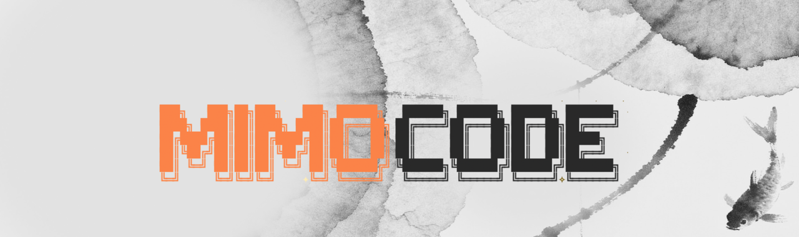

<h1 align="center">MiMo TUI</h1>

<p align="center">
  
</p>

<p align="center"><strong>Autonomous AI coding assistant for legacy hardware</strong></p>

<p align="center">
  <strong>No Bun • No opencode • No SolidJS</strong><br>
  Just Python + Rich + MiMo free-tier API
</p>

---

## Quick Start

### Windows
```bat
install.bat
run.bat
```

### Linux (Fedora/Ubuntu)
```bash
chmod +x install.sh run.sh
./install.sh
./run.sh
```

## What's Inside

| Component | Purpose |
|-----------|---------|
| **Brain** | Streaming + tool calling + Ollama fallback |
| **13 Tools** | File ops, git, python exec, shell, system monitor |
| **Memory** | SQLite knowledge graph, interactions, code library |
| **VibeCoder** | Auto-retry code generation |
| **Planner** | Autonomous task decomposition |
| **Cerebro** | Personality and learning |
| **AST Analyzer** | Python code quality checks |
| **Auth** | MiMo free-tier bootstrap + fingerprint |

## Commands

- `/help` — Show all commands
- `/mode [name]` — Switch mode (auto|code|plan|local|fast)
- `/model s|f` — Switch model (smart/fast)
- `/plan <goal>` — Add task to autonomous planner
- `/plans` — Show plan queue
- `/memory` — Memory statistics
- `/fact k=v` — Remember a fact
- `/ast <file>` — AST check Python file
- `/cwd [path]` — Change working directory
- `/tokens` — Token usage stats
- `/status` — System status (CPU/RAM)
- `exit` — Quit

## Modes

| Mode | Description |
|------|-------------|
| **AUTO** | Smart automatic (default) |
| **CODE** | Vibe coding with auto-retry |
| **PLAN** | Autonomous task planning |
| **LOCAL** | Ollama only (offline) |
| **FAST** | Small model, save tokens |

## Requirements

- Python 3.10+
- pip packages: `rich`, `psutil`
- Optional: Ollama (for local fallback)

## API

Uses MiMo free-tier via opencode.ai:
- **Auth:** device fingerprint (SHA-256)
- **Endpoint:** `https://opencode.ai/zen/v1/chat/completions`
- **Models:** mimo-auto, hy3-free, mimo-v2.5-free

## Credits

Borodachamba Studio © 2026
